  

  
  
  

  

  

  
  
  
  
  
  

About me

Aryan is the Chief Executive Officer and Managing Partner of The Moonlit Company and a pre-law student at Irvine Valley College (IVC).

An entrepreneur who achieved significant milestones at a young age, Aryan built his foundation on resilience. His operational expertise comes from starting multiple businesses, failing fast, and adapting faster. He is an expert in communication with extensive experience leading corporate teams and driving corporate strategy. Alongside his executive leadership, he also works in the technology sector as a Software Engineer Intern at Star Alliance.
Aryan’s relentless work ethic is rooted in ground-level operations, having honed his customer relations and management skills in fast-paced roles at Taco Bell, Target, and Nékter Juice Bar. He is currently studying to become a lawyer, aiming to bridge the gap between corporate execution, technology, and legal strategy. 

### Tech Stack:
               
And more i am just to lazy to put them
